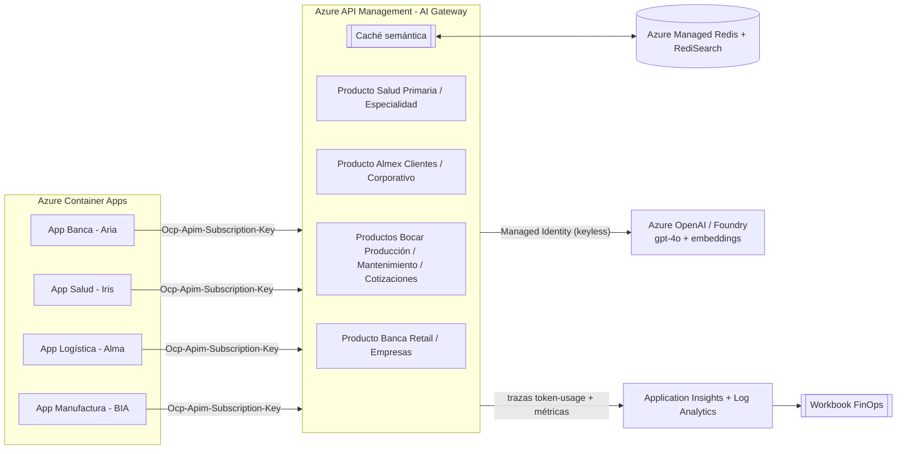

# Demos de IA Gobernada en Azure — Banca, Salud, Logística y Manufactura 🇲🇽🇪🇸

Cuatro demos en **español** que muestran, sobre **una misma plataforma de AI Gateway**, cómo Azure gobierna, asegura y controla el costo de aplicaciones de IA generativa empresarial.

| Demo | Agente | Escenario | Unidades de negocio |
|------|--------|-----------|---------------------|
| **Banca** | **Aria** | Disputas y reembolsos de tarjetas — Banco Contoso | Retail (10K TPM) · Empresas (40K TPM) |
| **Salud** | **Iris** | Información de productos médicos para visitadores médicos — Laboratorios Contoso | Atención Primaria (10K TPM) · Especialidad (40K TPM) |
| **Logística** | **Alma** | Analítica interna y operación de embarques — ALMEX | Logística Interna (10K TPM) · Cuentas Corporativas (40K TPM) |
| **Manufactura** | **BIA** | Scrap/retrabajo, mantenimiento predictivo y RFQ — Bocar | Producción y Calidad (30K TPM) · Mantenimiento (20K TPM) · Cotizaciones (15K TPM) |

Las cuatro comparten **una sola instancia** de Azure API Management, Azure OpenAI (Foundry), Azure Managed Redis, Application Insights y Container Apps Environment.

---

## 🚀 Desplegar en tu propio tenant

### Opción A — Botón "Deploy to Azure" (un clic)

[](https://portal.azure.com/#create/Microsoft.Template/uri/https%3A%2F%2Fraw.githubusercontent.com%2Fgracielars999%2Fazure-ai-governance-demos%2Fmain%2Fazuredeploy.json)

El botón provisiona **toda la plataforma** (Foundry + APIM + Redis + Container Apps + observabilidad), construye las imágenes de las cuatro apps desde este repo y las conecta al gateway. Solo necesitas elegir suscripción, grupo de recursos y región.

> ⏱️ El despliegue tarda **~35–45 min** (API Management es el componente más lento).
> 💡 Deja `buildAppImages = true` (valor por defecto) para que la demo quede lista y funcionando de una sola vez.

### Opción B — Azure Developer CLI (un comando)

```bash
git clone https://github.com/gracielars999/azure-ai-governance-demos.git
cd azure-ai-governance-demos
azd up
```

`azd up` provisiona la infraestructura y construye/despliega las cuatro apps automáticamente.

### Opción C — Azure CLI (manual)

```bash
az group create -n rg-ai-gov -l eastus2
az deployment group create -g rg-ai-gov \
  --template-file infra/main.bicep \
  --parameters apimPublisherEmail=tu-correo@empresa.com buildAppImages=false
# luego construye las imágenes y conéctalas:
./scripts/postdeploy.sh rg-ai-gov
```

👉 Guía detallada paso a paso: **[docs/despliegue.md](docs/despliegue.md)**

---

## 🏛️ Los 5 pilares que demuestra

1. **Foundry (Azure OpenAI)** — modelos `gpt-4o` y `text-embedding-3-small` desplegados y gobernados. *(Opcional: Foundry IQ / knowledge base, ver [`scripts/foundry-agent`](scripts/foundry-agent).)*
2. **AI Gateway (API Management)** — un único punto de entrada para todo el tráfico de IA, con caché semántica, enrutamiento y políticas.
3. **Seguridad** — autenticación **keyless** de APIM a Foundry con **Managed Identity** (sin llaves en el código), aislamiento por suscripción.
4. **Gobernanza** — **cuotas de tokens por minuto por unidad de negocio** (`azure-openai-token-limit`) definidas a nivel de *product* de APIM.
5. **AI FinOps** — medición de tokens y **chargeback** por unidad de negocio, **ahorro por caché semántica** y latencia, todo en un **Workbook de Azure**.

---

## 🗺️ Arquitectura



**Flujo:** cada app inyecta la llave de suscripción de *su* unidad de negocio → APIM revisa la **caché semántica** (HIT = 0 tokens, respuesta en ms) → si es MISS aplica la **cuota de tokens** del producto → autentica con **Managed Identity** a Foundry → emite **trazas y métricas** de FinOps a Application Insights.

---

## ✅ Después de desplegar

1. **URLs de las apps** — salen en los *outputs* del despliegue (`bancaAppUrl`, `saludAppUrl`, `almexAppUrl`, `bocarAppUrl`) o con:
   ```bash
   az containerapp show -g rg-ai-gov -n ca-banca-web --query properties.configuration.ingress.fqdn -o tsv
   ```
2. **Importa el Workbook de FinOps** — sube el `infra/finops-workbook.json` de cada demo (incluido `bocar-ai-demo`) en *Azure Monitor → Workbooks → Nuevo → Editor avanzado*, apuntando al Application Insights desplegado.
3. **Genera tráfico** (para poblar las estadísticas):
   ```powershell
   ./salud-ai-demo/infra/gen-traffic.ps1 -Base https://<saludAppUrl>
   ./almex-ai-demo/infra/gen-traffic.ps1 -Base https://<almexAppUrl>
   ./bocar-ai-demo/infra/gen-traffic.ps1 -Base https://<bocarAppUrl>
   ```
4. **Llaves por unidad de negocio** (si las necesitas fuera de la app):
   ```bash
   az apim subscription show -g rg-ai-gov --service-name <apim> --sid banca-retail --query primaryKey -o tsv
   ```

---

## 💰 Costo aproximado

Plataforma pensada para **demo** (SKUs económicos). Costo estimado si se deja encendida:

| Recurso | SKU | Notas |
|---------|-----|-------|
| API Management | Developer | ~50 USD/mes · **no** apto para producción |
| Azure OpenAI | pago por uso | según tokens consumidos |
| Azure Managed Redis | Balanced_B0 | el más económico con RediSearch |
| Container Apps | consumo | escala a 1 réplica |
| Log Analytics / App Insights | pago por uso | bajo en demo |

> 🧹 **Apaga la demo** cuando termines: `az group delete -n rg-ai-gov --yes`

---

## 📁 Estructura del repo

```
azure-ai-governance-demos/
├─ azuredeploy.json          # ARM compilado (botón Deploy to Azure)
├─ azure.yaml                # azd up
├─ infra/
│  ├─ main.bicep             # plataforma compartida (fuente)
│  └─ main.parameters.json
├─ scripts/
│  ├─ postdeploy.sh / .ps1   # construir imágenes + conectar + llaves
│  └─ foundry-agent/         # (opcional) pilar Foundry IQ
├─ banca-ai-demo/            # app Aria + políticas + knowledge + workbook + guía
├─ salud-ai-demo/            # app Iris + políticas + knowledge + workbook + gen-traffic
├─ almex-ai-demo/            # app Alma + políticas + knowledge + workbook + gen-traffic
├─ bocar-ai-demo/            # app BIA + casos de manufactura + workbook + guía
└─ docs/despliegue.md        # guía detallada
```

Cada demo tiene su propio README: **[banca-ai-demo](banca-ai-demo/README.md)** · **[salud-ai-demo](salud-ai-demo/README.md)** · **[almex-ai-demo](almex-ai-demo/README.md)** · **[bocar-ai-demo](bocar-ai-demo/README.md)**.

---

## 🔒 Seguridad

- **No hay secretos en el repo.** Las llaves se generan en el despliegue y se inyectan en las apps como *secrets* de Container Apps vía Bicep.
- APIM se autentica a Foundry con **Managed Identity** (rol *Cognitive Services User*), sin llaves de API en el código.
- Los archivos `deployment-outputs.example.md` son plantillas con marcadores; los reales (`deployment-outputs.md`) están en `.gitignore`.

---

## 📄 Licencia

[MIT](LICENSE). Demo con fines educativos y de habilitación. Todos los datos operativos, clientes, activos, órdenes, lotes y RFQ son **ficticios**. Bocar se usa únicamente como contexto de demostración solicitado por el usuario.
